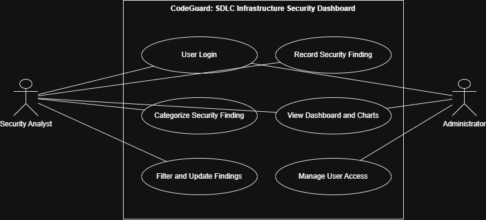
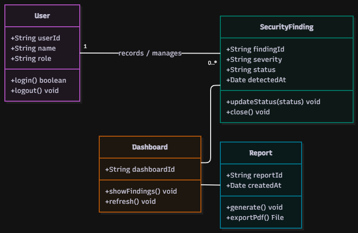

# CodeGuard: SDLC Infrastructure Security Dashboard

## 1. Introduction

Software development involves several stages, including writing code, managing source code, building applications, storing software packages, and deploying applications into production. Each stage depends on tools and infrastructure that may be exposed to security threats.

The SDLC Infrastructure Threat Framework (SITF) highlights the importance of securing the infrastructure used throughout the Software Development Life Cycle (SDLC). CodeGuard is a proposed web-based dashboard that will help software development teams record, monitor, and manage security findings across these stages.

The system will be developed using Python and Django, with Matplotlib used to visualize security information through charts and summaries.

## 2. Problem Statement

Software development teams may face security risks arising from compromised development environments, version control systems, CI/CD pipelines, software registries, and production infrastructure. If these risks are not properly recorded and monitored, teams may find it difficult to understand their severity, track their progress, and prioritize corrective actions.

CodeGuard aims to address this challenge by providing a centralized dashboard where security findings can be recorded, categorized, reviewed, and tracked until resolution. The proposed system will support security awareness and risk management throughout the software development process.

## 3. Project Objectives

### 3.1 General Objective

To develop a web-based dashboard that supports the recording, monitoring, visualization, and management of security findings across the Software Development Life Cycle.

### 3.2 Specific Objectives

1. To provide a facility for recording security findings affecting SDLC infrastructure.
2. To categorize findings according to SDLC infrastructure area, severity, and status.
3. To allow authorized users to view, filter, and update security findings.
4. To display summary statistics and charts that help users understand the current security situation.
5. To apply secure coding practices, version control, and automated testing during development.

## 4. Project Scope

The initial version of CodeGuard will focus on recording and managing security findings through a web-based interface. Its main features will include user authentication, security finding management, categorization by SDLC infrastructure area, status tracking, and a dashboard displaying summary statistics and charts.

The system will use sample or manually entered findings for demonstration purposes. Automatic detection of real cyberattacks and integration with live enterprise security tools will be outside the initial project scope.

The system will cover five SDLC infrastructure areas: Endpoint/IDE, Version Control System (VCS), CI/CD, Software Registry, and Production.

## 5. Proposed System Models

### 5.1 Use Case Diagram

The use case diagram illustrates how the Security Analyst and Administrator interact with the CodeGuard system. It shows the main functions available to each user, including recording security findings, viewing dashboard statistics, updating findings, and managing user access.

**Figure 1: CodeGuard Use Case Diagram**

### 5.2 Class Diagram

## 6. Application of Lean Software Development

CodeGuard will adopt Lean Software Development principles by focusing on delivering essential functionality, reducing unnecessary work, and improving the system through continuous feedback. The team will prioritize core features such as security finding management, severity categorization, status tracking, and dashboard visualization before implementing additional features.

Development will be carried out incrementally, allowing the group to test individual components, identify defects early, and improve the system based on feedback. Version control through GitHub and task tracking through Trello will support collaboration, transparency, and continuous improvement.

## 7. References

- SDLC Infrastructure Threat Framework (SITF). https://wiz-sec-public.github.io/SITF/
- Berkovich, S. (2026, March 20). *Securing the Code Factory: Why SDLC Infrastructure Has Become a Core Cloud Risk.*SD Times. https://sdtimes.com/author/shay-berkovich/
- MindInventory. (n.d.). Lean Software Development. https://www.mindinventory.com/blog/lean-software-development/
